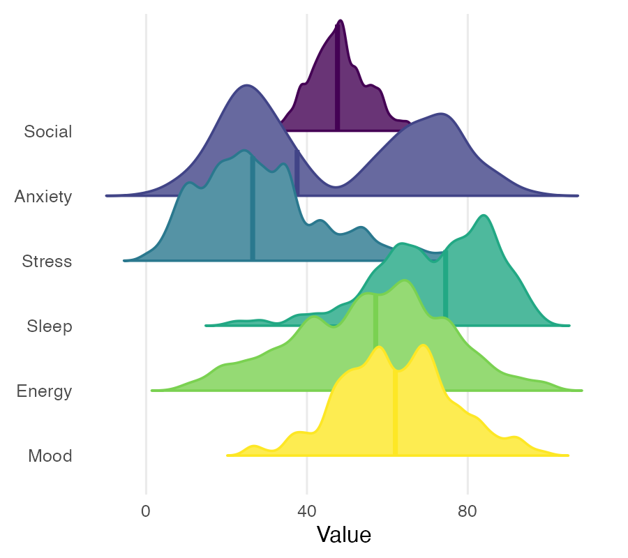
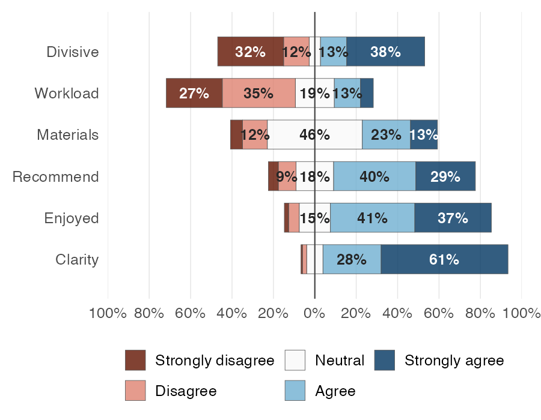
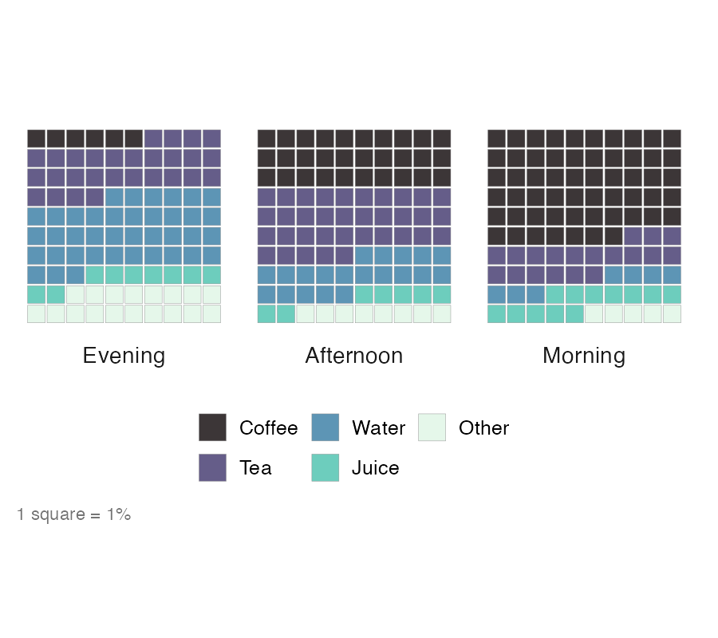

# comparePlots

[](https://doi.org/10.5281/zenodo.24401092)

A jamovi module to **compare the distributions of variables at once**, side by side on one shared scale. Drop your variables in, tick the plots you want, and get them all in one go. No code needed.

Five analyses, in jamovi's **Plots** tab, in two sections of the comparePlots menu:

*Compare Variables*
- **Compare Numeric**
- **Compare Ordinal** (Likert-type items)
- **Compare Nominal**

*Compare Groups* (numeric variables across the levels of a grouping variable)
- **Compare Dichotomous**: two groups; adds the split violin, the back-to-back histogram (age-by-sex pyramids and the like), a percentile ladder, a lead plot (running difference of the two cumulative distributions) and density overlap shading
- **Compare Polytomous**: three or more groups

All five work the same way: pick variables, set a few shared appearance options, then **tick any combination of plots**. Every plot appears as its own result and has its own collapsible settings panel.

---

## Install

Build and install the module into jamovi with [jmvtools](https://dev.jamovi.org/tuts0101-getting-started.html); see [Build from source](#build-from-source) below. This produces a `.jmo` for your own system, which can also be shared and installed in jamovi via:

**Modules (+) → jamovi library → Install from file…**

Example datasets are included and appear under **Open → Data Library → comparePlots**. The same files are in [`data/`](data/).

---

## Compare Numeric

Shared appearance: orientation (horizontal by default) · transform values (none, z-scores, ln, square root, square) · order variables by (entry order, name, median, mean) · reverse the order · palette and theme (both follow jamovi's own settings by default; own palettes and themes are available) · invert palette · text size · opacity · line thickness · point size · jitter spread · axis label · title. Plots have a fixed default size (drag a plot's corner to resize it).

| Plot | Settings |
|---|---|
| Box plot | width, outliers, notches, mark the mean, jittered data points |
| Violin plot | width, scale, bandwidth, trimming, inner box, jittered data points |
| Means and error bars | centre (mean/median), error bars (CI / SE / SD / IQR / central % / min–max), level, multiplier, jittered data points (on by default), marker size, caps, connecting line, value labels |
| Raincloud plot | cloud height, bandwidth, rain on/off, box on/off |
| Ridgeline plot | overlap, bandwidth, trimming, median marker (lower ridges cover the ones behind) |
| Histogram | bins on a shared scale, count/percent/density, density curve, free height per variable |
| Overlaid densities | bandwidth, fill, trimming |
| Cumulative distribution (ECDF) | median guide |
| Data points (strip) | mean/median line |
| Barcode plot | tick height |

## Compare Ordinal and Compare Nominal

Shared appearance: orientation (horizontal: charts stacked top to bottom; vertical: side by side) · order variables (entry order, A–Z, mean, median, % in first/last category, net %) · reverse the order · palette and theme (both follow jamovi's own settings by default) · invert palette · text size · opacity · line thickness · decimals · legend position/title · title · n per variable · ignore missing cases.

| Plot | Settings |
|---|---|
| Stacked bars (100%) | thickness, % labels, smallest % to label |
| Diverging bars (Likert style) | thickness, middle category handling, % labels, net % on each side |
| Heatmap | colour scale, % in tiles, tile gap |
| Waffle chart | rows × columns per chart (10 × 10 by default, so 1 square = 1%), gap |
| Dot pictogram | rows × columns per chart (10 × 10 by default), shape, size |
| Parliament chart | seats, rows, seat size |
| Response profile (lines) | lines, points, % values |

---

## Compare Groups (Compare Dichotomous, Compare Polytomous)

Numeric variables across the levels of **one grouping variable**; colour is the group. *Compare Dichotomous* needs exactly two groups (and says so otherwise); *Compare Polytomous* takes any number. Both offer the ten numeric plots of Compare Numeric, split by group, and the same Appearance box; a nominal, ordinal (its level order is kept: set the measure type to *Ordinal* in jamovi) or two-level grouping variable all work.

Shared settings (besides those of Compare Numeric): **group display** (within each variable, panels by group, panels by variable) · reverse group order · ignore missing group cases · **reference line** at the overall mean or median · **show n in group labels** · angle of x axis labels (horizontal, 45°, 90°) · explanatory note below the plot (off by default; all analyses have it). Plots are sized from the number of variables and groups, and the analyses warn about empty variables or variable-by-group cells, variables with no spread in a group, and grouping variables with more than 8 levels.

Only in **Compare Dichotomous** (two groups):

| Plot | What it shows |
|---|---|
| Split violin | the two groups as the two halves of one violin |
| Back-to-back histogram | the population-pyramid layout (e.g. age by sex): upright with vertical orientation, mirrored with horizontal; counts or percent of group |
| Percentile ladder | the two groups' values at each percentile (quartiles, deciles or every 5th), joined by a bar coloured by the higher group: *where* in the distribution they differ |
| Lead plot | at each value, the share of group 1 at or below it minus the share of group 2 (the running difference of the two cumulative distributions), with a two-row barcode of the data and the largest gap marked |
| Density overlap | in *Overlaid densities*: shades where the two curves overlap and reports the overlap as a percentage |

These plots *describe* the samples; none of them draws an uncertainty band, so with few observations per group treat their shapes with caution.

---

## Example data

| File | Contents |
|---|---|
| `data/example_numeric` | Six 0–100 scales with different shapes: normal, skewed, bimodal, narrow (n = 240) |
| `data/example_ordinal` | Six Likert items with different response patterns (n = 300) |
| `data/example_nominal` | One five-category nominal variable at three times of day (n = 250) |
| `data/example_groups` | Six measures and four grouping variables: Group (3 arms), Sex (dichotomous), SES (ordinal, 3 levels), Site (nominal, 4 levels): shifts between groups, skewed, ceiling and narrow variables, strictly positive reaction times, a change score with negatives, uneven group sizes, a few missing values (n = 270) |

Each is provided as `.omv` (variable types already set) and `.csv`. Regenerate with `Rscript tools/make_examples.R`.

---

## What it looks like

These are only a small subset of the plots available. Complete jamovi results with several plots each (PDF exports): [numeric](docs/examples/numeric-example.pdf) · [ordinal](docs/examples/ordinal-example.pdf) · [nominal](docs/examples/nominal-example.pdf).

**Ridgeline plot** (Compare Numeric): six scales on one 0-100 axis, with the medians marked.

<p align="center"></p>

**Diverging bars** (Compare Ordinal): six Likert items.

<p align="center"></p>

**Waffle charts** (Compare Nominal): the same drink question at three times of the day; one square is 1%.

<p align="center"></p>

---

## Languages

The interface (menus, option labels, results titles) is available in **Spanish** (`jamovi/i18n/es.po`); choose it in jamovi's settings. Plot texts and notices are only partly translated so far. Further languages: `jmvtools::i18nCreate("<code>")`, then translate the `.po` file.

---

## Build from source

The sources follow the standard jamovi module layout (`jamovi/` for the `.yaml` definitions and UI, `R/` for the implementation). With the [jmvtools](https://dev.jamovi.org/tuts0101-getting-started.html) R package and jamovi installed:

```r
jmvtools::install()      # build and install into your jamovi
```

`R/*.h.R` are generated by jmvtools from `jamovi/*.a.yaml`; edit the yaml, not the `.h.R` files.

---

## Layout

```
jamovi/    0000.yaml (manifest), *.a.yaml (options), *.r.yaml (results), *.u.yaml (UI), i18n/ (translations)
R/         *.b.R (implementation), utils.R and catCommon.R / cmpGrpCommon.R (shared code), *.h.R (generated)
data/      example datasets (shown in jamovi's Data Library)
tools/     make_examples.R (example datasets), the generators for the UI and option files, fill_es_po.py (Spanish translation)
docs/      build instructions, example images (images/), example results as PDF (examples/)
icons/     module icon (comparePlots.svg, 74 x 44, jamovi ribbon style)
```

### Where to change things

| To change... | Edit |
|---|---|
| an option (name, default, range, choices) | `jamovi/<analysis>.a.yaml`, then add the control to `<analysis>.u.yaml` and, if it affects a plot, to that image's `clearWith` in `<analysis>.r.yaml` |
| how a plot looks | the `.p_<plot>` function in `R/<analysis>.b.R` |
| something shared (palettes, themes, statistics) | `R/utils.R` |
| the menu entries or example data list | `jamovi/0000.yaml` |
| the group analyses (options and results) | `jamovi/distDich.{a,r}.yaml` only, then `python3 tools/gen_group_analyses.py` writes the Polytomous ones; the code is `R/cmpGrpCommon.R` |
| the UI of Compare Numeric / the group analyses / Ordinal and Nominal | `tools/gen_numeric_ui.py` / `tools/gen_numeric_ui.py` / `tools/gen_categorical_yaml.py` |
| a Spanish translation | add the new strings to `tools/fill_es_po.py`, run `jmvtools::i18nUpdate("es")` then `python3 tools/fill_es_po.py` |

Do not name an option `theme` or `palette`: jamovi reserves those for its global plot settings (the module uses `plotTheme` and `colourPalette`).

## Authorship and development

**Author and maintainer:** Herman E. Elgueta (herman.elgueta@umag.cl), Departamento de Psicología, Universidad de Magallanes, Punta Arenas, Chile.

Developed for the **Laboratorio Austral de Medición Psicosocial (LAMP)**, Universidad de Magallanes, and maintained in the author's personal repository.

**How it was written:** the code is largely AI-generated (Claude Sonnet 5.5, Anthropic), following the official jamovi developer manuals and documentation, then human-reviewed (by the author) and tested on macOS, Linux and Windows. The code is heavily commented so that people, or other tools, can follow and change it.

## How to cite

If you use comparePlots in your research, please cite it:

> Elgueta, H. E. (2026). *comparePlots: Compare the distributions of variables* (Version 1.1) [jamovi module]. Zenodo. https://doi.org/10.5281/zenodo.24401092

This DOI always points to the latest version; each release also has its own DOI, listed on the [Zenodo page](https://doi.org/10.5281/zenodo.24401092). GitHub's **Cite this repository** button (from [CITATION.cff](CITATION.cff)) gives the same reference in APA and BibTeX.

## License

GPL-2 or later (GPL (>= 2)); see [LICENSE](LICENSE).
